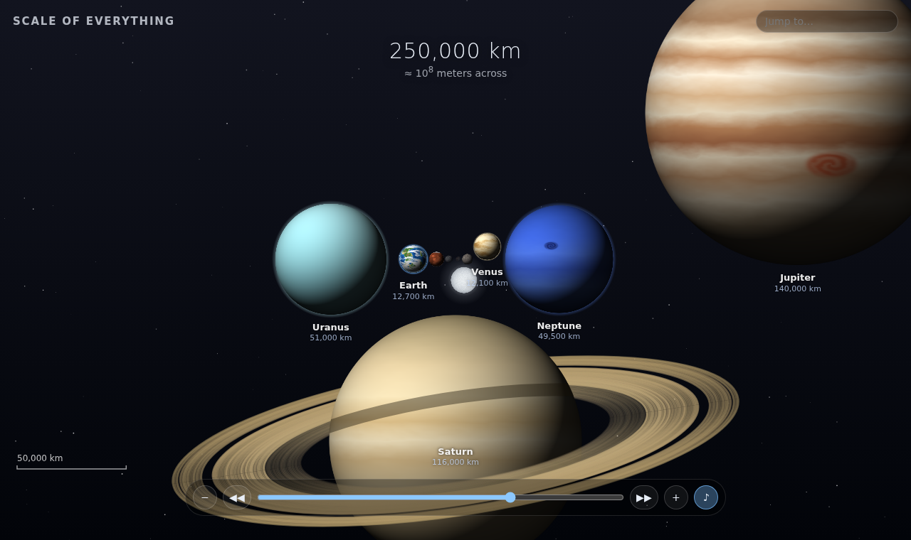

# Scale of Everything

A zoomable journey from the Planck length to the edge of the observable universe, inspired by *Scale of the Universe 2*. Everything is drawn and synthesized in the browser. There are no images, audio files, libraries or build step.

**Play:** open `index.html` in a browser.

## Controls

| Action | How |
| --- | --- |
| Zoom | Scroll, drag up/down, the slider, or ↑ ↓ / + − (Page Up/Down jumps 3 powers of ten) |
| Auto-zoom | ◀◀ / ▶▶, or Space |
| Learn about an object | Click it, or type its name in **Jump to…** |
| Heart an object | ♥ in its card (or H). Hearts are pinned on the scale bar; click one to fly there |
| Music | ♪ button, or M |

## Files

- `objects.js`: the catalogue: name, size in meters, drawing kind, colors, and a one-line fact for each object.
- `art.js`: procedural drawings for every kind, plus generated textures for planets, moons and stars.
- `music.js`: a generative ambient soundtrack built with the Web Audio API.
- `app.js`: layout, camera, rendering, input, hearts and the info card.
- `index.html`, `style.css`: the page and its controls.

To add an object, add one line to `objects.js`. The layout places it automatically.
